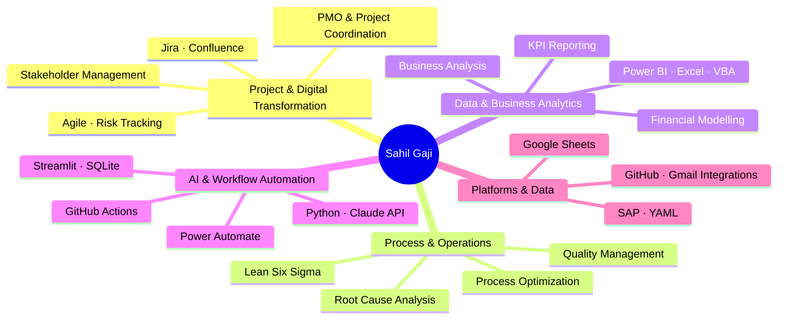

<!-- =========================================================
     SAHIL GAJI | GITHUB PROFILE README
     Design: Clean · Structured · Professional
     ========================================================= -->

# Sahil Gaji

### Digital Transformation · Project Management · Process Excellence · AI & Analytics

**Bridging business needs, technology, and operational improvement.**

  
  
  
  

---

## `01` · About

Digital transformation and project coordination professional with an **M.Sc. in Digital Transformation Management: Business Analytics** and an engineering background.

Interested in turning complex business problems into structured projects, measurable improvements, and practical digital solutions.

**Focus areas:** PMO & project delivery · Process optimization · Business analysis · AI-enabled automation · Data-driven decision-making

---

## `02` · Professional Journey

<strong>Digitalization & Project Management</strong> · Robert Bosch GmbH

- **Role:** Project Management & Digitalization Intern
- **Focus:** PMO support, project governance, Jira roadmaps, risk tracking, and cross-functional coordination
- **Digital enablement:** Power BI KPI reporting, workflow automation, knowledge management, and tool adoption
- **Impact:** Supported standardized Jira practices for 150+ managers and team leads; improved information retrieval and workflow efficiency

<strong>Renewable Energy & Financial Advisory</strong> · Dornier Suntrace / Lahmeyer International

- **Role:** Project Development & Finance Advisory Intern
- **Focus:** Renewable infrastructure, business cases, financial modelling, investment analysis, and project feasibility
- **Methods:** DCF, NPV, ROI, CAPEX/OPEX, Excel VBA, market research, and proposal development
- **Impact:** Automated recurring forecasting and tracking activities, saving approximately five person-days per month

<strong>Fulfillment & Operational Quality</strong> · Picnic

- **Role:** Quality Specialist, FC5
- **Focus:** Fulfillment operations, quality checks, operational standards, process compliance, and issue identification

<strong>Manufacturing & Quality Engineering</strong> · KEIHIN FIE / Hitachi Astemo

- **Role:** Quality Assurance Engineer
- **Focus:** Manufacturing quality, SAP inventory processes, QMS, defect analysis, and continuous improvement
- **Impact:** Contributed to defect reduction and shorter process cycle times through data-led quality improvements

<strong>Automotive Research & Market Intelligence</strong> · GirnarSoft / ZigWheels

- **Role:** Junior Market Correspondent
- **Focus:** Automotive industry research, market intelligence, competitor analysis, and content development

<strong>Entrepreneurship & Product Development</strong> · Club House / Makerspace – Creators' Catalyst

- **Focus:** Early-stage venture development, product concepts, experimentation, and collaborative problem-solving

---

## `03` · Projects & Digital Builds

<table>
<tr>
<td width="50%" valign="top">

### <a href="https://github.com/sahilgaji/job-automation">AI-Powered Job Search Automation</a>

`AI` `Python` `Workflow Automation`

- Job discovery and eligibility rules
- Multi-persona role evaluation
- Tailored application content
- Confidence scoring and workflow orchestration

</td>
<td width="50%" valign="top">

### PMO & Digitalization

`Jira` `Power BI` `Process Design`

- Project tracking and governance
- KPI dashboards and reporting
- Knowledge management
- Digital tool adoption

</td>
</tr>
<tr>
<td width="50%" valign="top">

### Financial Analysis & Forecasting

`Excel VBA` `Financial Modelling`

- Business case development
- Investment and feasibility analysis
- Forecasting and resource tracking
- Renewable energy project evaluation

</td>
<td width="50%" valign="top">

### Quality & Operations Analytics

`Power BI` `SAP` `QMS`

- Quality performance monitoring
- Defect and trend analysis
- Operational reporting
- Continuous improvement

</td>
</tr>
</table>

  Personal builds, professional experience, and learning projects are presented as distinct workstreams.

---

## `04` · Skills & Technology Map

**Core strengths:** Project coordination · Digital transformation · Process excellence · Business analysis · Data-driven improvement

**Technical toolkit:** Jira · Confluence · Power BI · Excel/VBA · Python · Claude API · Power Automate · GitHub Actions · Streamlit · SQLite · SAP · YAML

---

## `05` · Education

<table>
<tr>
<td valign="top" width="50%">

**M.Sc. · Digital Transformation Management: Business Analytics**

SRH Berlin University of Applied Sciences  
`2022–2024` · GPA: 2.0

*Academic focus: digital transformation, business analytics, and communication in virtual teams.*

</td>
<td valign="top" width="50%">

**B.Eng. · Mechanical Engineering**

Savitribai Phule Pune University  
`2015–2019` · GPA: 2.4

*Academic focus: engineering fundamentals, refrigeration and air conditioning, and cold-storage design.*

</td>
</tr>
</table>

---

## `06` · Certifications

- Google Project Management Professional Certificate
- Google Data Analytics Professional Certificate
- Business Analysis Foundations · LinkedIn Learning
- Lean Six Sigma Yellow Belt
- Introduction to Power BI · DataCamp
- Introduction to Python · DataCamp

---

## `07` · Beyond the Toolkit

- **Industries:** Digital transformation · Manufacturing · Renewable energy · Retail fulfillment · Automotive
- **Methods:** Project coordination · Process mapping · Root-cause analysis · KPI-driven improvement
- **Languages:** English · Hindi · Marathi · German (actively improving)

---

### Open to meaningful problems and collaborative projects

**Digital transformation · PMO & project coordination · Process excellence · Business analysis · AI-enabled workflows**

<a href="https://www.linkedin.com/in/sahil-gaji/">Connect on LinkedIn</a> ·
<a href="https://sahilgaji.github.io/">Explore my portfolio</a>

